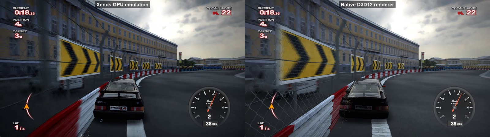
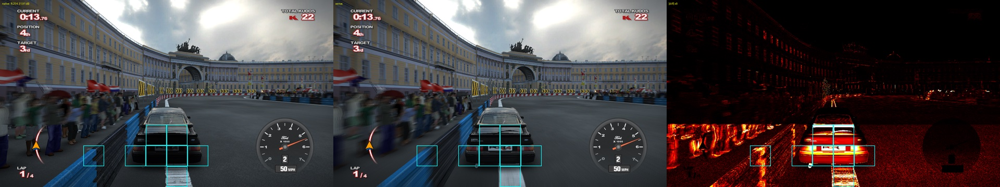

# pgr4-native

A native Direct3D 12 renderer for the Project Gotham Racing 4 static recompilation
([MissingThePixel/MTR-PGR4](https://github.com/MissingThePixel/MTR-PGR4), built on the
[ReXGlue](https://github.com/rexglue/rexglue-sdk) SDK).

The recompiled game normally draws through ReXGlue's Xenos plugin, which emulates the Xbox 360
GPU by replaying its command stream. This renderer hooks the game's own Xbox 360 D3D calls in
the recompiled code instead (197 functions: draws, clears, resolves, Swap and the state calls
around them) and turns each one into D3D12 work.

The goal is 1280x800 at 60 fps under Proton on a Steam Deck.

Two runs of the same scripted race, 18 seconds in. The cars take slightly different lines
because the physics is not identical between runs. The native side is missing the car's rear
spoiler, a known bug.

## Summary (2026-10-21)

Measured on an i9-13900K with an RTX 3090, St Petersburg street race, uncapped, same build for
every row.

| | Native renderer | Xenos plugin |
|---|---|---|
| Windows | 129 fps with the render thread, 96 fps without | 126 fps |
| Linux, Proton | 112-116 fps with the render thread, 91-92 fps without | 113-114 fps |
| Proton, game limited to 8 efficiency cores | 80 fps with the render thread, 57 fps without | 72 fps |
| CPU cores kept busy (Windows) | about 1.4 with the render thread | about 2 |
| Race image against the Xenos plugin | 31-33 dB PSNR | reference |

- Title screen, menus and the St Petersburg race render. That route is the only one tested.
- The car's rear spoiler is missing.
- The render thread (`--pgr4_native_render_thread`) is off by default until an image bug it
  causes is fixed (see [Image accuracy](#image-accuracy)).
- Not run on a Steam Deck yet.
- The game runs at 30 fps by default; MTR-PGR4's `--pgr4_60fps` makes it 60, which has not been
  tried with this renderer yet. The uncapped numbers above measure how much headroom there is.

## Why a native renderer can beat emulation

- PGR4 renders with predicated tiling. The Xbox 360 GPU draws into 10 MB of EDRAM, and the game
  splits each frame into screen tiles that the GPU replays the draws for. In the race the game
  makes about 3,300 draw calls per frame, and the Xenos plugin executes about 5,500 GPU draws
  because it runs them for two tiles plus an untiled pass. The native renderer sees each D3D
  call once and draws it once at full size.
- With the Xenos plugin, the game thread and the plugin's command-processing thread keep about
  two cores busy. The native renderer starts from the D3D calls and costs about 0.9 µs of CPU
  per draw. With the render thread, that work moves off the game thread onto a second thread
  that is about 43 % busy.
- The game's own code takes about 8 ms per frame on the 13900K. That sets the floor for both
  renderers.

## Performance

### How it is measured

- A key script drives the game from boot through a new profile to the St Petersburg street race
  (Arcade, chapter 1, event 1) and holds the throttle.
- Frame time is the average over the 40 seconds after the race starts, taken from the game's own
  log (`native/tools/perf_fps.py`). Runs are uncapped (`--vsync=false
  --d3d12_present_vsync=false`), which does not change PGR4's game speed.
- Two runs of the same build differed by 8 % in one test, because the scene at a given second
  changes a little from run to run. To compare two builds or two flag sets, runs alternate
  (A, B, B, A, ...) and `native/tools/ab_compare.py` compares them in 4-second bins at the same
  point of the race. One pair of runs gave a 95 % interval of about ±3 %.

### Windows

| Configuration | ms per frame | fps |
|---|---|---|
| Native, render thread on | 7.76 | 129 |
| Xenos plugin | 7.95 | 126 |
| Native, render thread off | 10.46 | 96 |

Paired comparison on the same build: turning the render thread on takes frame time from 11.09
to 8.16 ms, -26.3 % (95 % interval -29.3 to -23.2 %).

How the native frame rate got there, with the Xenos plugin on the same build for reference:

| Change | Native fps | Xenos fps |
|---|---|---|
| First build where the native renderer is the game's output | 46 | 130 |
| Texture conversions stop reading write-combined upload memory (14 ms per frame); textures placed in heaps; untiling and pipeline compiles on worker threads | 92 | 123 |
| Texture binding memo, draw-path memos, cached constant buffer memory, persistent pipelines | 100 | 130 |
| Render thread | 129 | 126 |

Per-draw CPU cost in steady race frames, before the render thread: textures 218 ns, constant
buffers 175 ns, vertices 120 ns, state tracking 115 ns, command recording 113 ns.

### Linux and Proton

GE-Proton 11-11 (vkd3d-proton) in a Hyprland session on the same PC, running the same Windows
build.

| Configuration | ms per frame | fps |
|---|---|---|
| Native, render thread on | 8.65-8.94 | 112-116 |
| Xenos plugin | 8.77-8.86 | 113-114 |
| Native, render thread off | 10.88-10.99 | 91-92 |
| Native, render thread on, 1280x800 window | 8.72 | 115 |

- With the render thread on, native and Xenos are level under Proton: -3.3 % (95 % interval
  -10.1 to +3.5 %). With it off, Xenos takes 17.5 % less time per frame than native.
- Against Windows, Proton makes the Xenos plugin about 11 % slower and native with the render
  thread 8-13 % slower. Native without the render thread is within 5 %.
- The race image check gives 31.5-31.7 dB, the same as on Windows, and vkd3d-proton logged no
  errors.
- The 1280x800 window runs at the same speed as 1280x720.

### A slower CPU

There is no Steam Deck to test on yet. As a rough stand-in, the game was pinned to eight of the
13900K's efficiency cores (eight threads, no SMT) under Proton. The GPU is still an RTX 3090, so
this only says something about the CPU side. A Deck's Zen 2 cores are slower again.

| Configuration | ms per frame | fps |
|---|---|---|
| Native, render thread on | 12.50 | 80 |
| Xenos plugin | 13.96 | 72 |
| Native, render thread off | 17.69 | 57 |

On these cores native with the render thread takes 14.7 % less time per frame than Xenos (95 %
interval 5.9 to 23.6 %), and the render thread cuts native frame time by 30.8 %.

### Hitches

- The frame where the race starts went from 357 ms to 76 ms with cold caches and 84 ms with warm
  ones.
- A run from boot to the race has 3 frames of 50 ms or more, down from 9. Two of the three are
  start-up and a loading screen.
- What fixed it: texture conversions no longer read back write-combined memory (98 to 2.8 ms for
  a 1280x720 depth upload); textures are placed in heaps instead of created one by one (138 to
  9.5 ms for 627 textures); untiling and pipeline compiles run on worker threads; upload blocks
  are reserved at start-up; polygon offset is dynamic state instead of part of each pipeline
  (957 to 316 pipelines in a cold run); pipelines persist across runs.
- Still left at race start: first vertex copies (14-26 ms), untiling work the first submit waits
  for (about 48 ms), and shader translation in a cold run.

## Image accuracy

The image check runs both renderers side by side (`--pgr4_native`, `--readback_resolve=fast`),
captures both front buffers at three race frames and compares them. A capture passes at 30 dB
PSNR or more. Race frames score 31-33 dB and menus 34-40 dB.

`native/tools/oracle_diff.py` makes images like this one and scores each 80x80 tile and each
40-row band. What it shows:

- The worst tiles are around the player's car (17-19 dB, against a median tile of about 46 dB),
  where the spoiler is missing.
- The difference jumps at row 480. In the six race captures checked (three on Windows, three
  under Proton), the mean difference per pixel is at most 1.1 (out of 255) in each 40-row band
  above row 440, and 3.3 to 8.2 in each band from row 480 down. The game renders two screen
  tiles plus an untiled pass per frame, and a first tile of about 480 rows would fit in the
  EDRAM, so this may be the tile boundary. Not verified yet.
- With the render thread on, one capture in three drops to 29.5 dB. In one it is an extra dark
  polygon in the sky, in another a bright band along the far barriers. Both are wrong geometry,
  so the likely cause is vertex or register data reaching the render thread late or out of
  order.

## Bugs found on the way

| Symptom | Cause | Fix |
|---|---|---|
| Car garbled, crowd missing | The game writes a patched copy of each vertex shader (matched to the vertex declaration) into the command buffer; the renderer used the original microcode | Copy the patched microcode in a hook |
| Frame turns white after tone mapping | ReXGlue's shader translator numbers texture and sampler slots from 1; the binding table was filled from 0 | Size the table to the highest slot plus one |
| Image check stuck near 25 dB | Fast readback returns the previous resolve | Hold a full readback for the compared frame |
| One cube map face at 5 dB | The Xenos plugin packs each 7e3 float sample (flushing values below 2^-9) before averaging MSAA samples; the renderer averaged first | Pack each sample before averaging |
| Lost frames at the title screen | The game creates a second D3D device | Follow the device that Swap and the draws use |
| Clip plane mismatches | The clip-plane register block is 8 registers and the planes flush from a different device field | Map the block correctly |
| 14 ms per frame lost | Texture untiling wrote into write-combined upload memory and the format conversion read it back (about 55 ns per byte) | Convert in a cached scratch row, then copy whole rows out |

## How it works

- `native/src/pgr4_d3d_trace.cpp` hooks the guest D3D functions listed in
  `native/src/d3d_surface.inc`. Each hook calls the original guest function first, so the guest
  D3D state and the Xenos plugin stay correct, then passes the call to the renderer.
- `d3d_state` tracks the Xenos register state the guest D3D device writes for each draw.
- Shaders: Xenos microcode goes through ReXGlue's DXBC shader translator
  (`shader_translate`, `shader_cache`).
- Textures (`textures`, `texture_layout`): guest textures are untiled on CPU worker threads into
  upload memory and copied into placed resources. Guest writes are caught with page watches.
- Render targets and resolves (`render_targets`, `resolve`): the 360's EDRAM targets become host
  render targets; resolves copy them into host textures that later draws sample.
- Pipelines (`draw`, `pipeline_store`): pipeline states compile on a worker thread and persist
  across runs in an `ID3D12PipelineLibrary` under the runtime's cache folder.
- With `--pgr4_native_render_thread`, the game thread only captures each call and its state; a
  render thread records and submits the D3D12 work.
- `present` presents the guest's front buffer into the game window or a debug window.

Several files port Xenia/ReXGlue code (BSD-3-Clause), among them `draw`, `render_targets`,
`resolve`, `geometry_shader` and the texture code. Their headers name the ported functions.

## Building

You need Windows 10 or 11, Visual Studio 2022 Build Tools (x64), LLVM (clang-cl), CMake, Ninja,
PowerShell 7 and Git. You also need the files from your own PGR4 disc, extracted to a folder
(`default.xex`, `gw.xex`, `Game\`, `UI\` and so on). This repository contains no game data, and
the recompiled C++ that the build generates from `default.xex` must not be published.

1. Build MTR-PGR4 and its patched ReXGlue SDK:
   `pwsh -File build\build-mtr.ps1 -Root C:\recomp\builds\pgr4 -Game <disc folder> -Stage prep,sdk`
2. Build the renderer into its own tree. This copies the MTR-PGR4 checkout, applies the two SDK
   patches, adds the hooks and `native\src\native\` to the game, then builds:
   `pwsh -File native\build.ps1 -Root C:\recomp\builds\pgr4 -Game <disc folder> -Dest <tree>`
3. Run it: `pwsh -File native\run.ps1 -Action start -Dest <tree> -Game <disc folder> -Native -Extra "--pgr4_native_primary"`.
   Add `--pgr4_native_render_thread` to the `-Extra` flags for the faster path. `run.ps1`
   starts the game in the interactive desktop session through a scheduled task, so it also
   works over SSH. `-Action stop` closes it. The game's executable is
   `<tree>\run\runtime\pgr4_recompiled.exe`.

`build.ps1` expects `native\` and `instrument\` side by side, as in this repository.

Under Proton the same Windows build runs as it is: start `pgr4_recompiled.exe` with
`proton run` and the game flags that `run.ps1` passes.

## Flags

| Flag | Default | Effect |
|---|---|---|
| `--pgr4_native` | false | Run the native renderer beside the Xenos plugin, in a debug window |
| `--pgr4_native_primary` | false | The native renderer is the game's output; implies `--pgr4_native` |
| `--pgr4_native_render_thread` | false | Record and submit on a render thread; the game thread only captures each call |
| `--pgr4_native_async_pipelines` | true | Compile new pipelines on a worker thread; draws wait for theirs |
| `--pgr4_native_pipeline_cache` | true | Keep pipelines across runs |
| `--pgr4_native_dynamic_depth_bias` | true | Set polygon offset per draw instead of per pipeline |
| `--pgr4_native_csv=<file>` | off | Per-frame counters and CPU times |
| `--pgr4_native_profile` | false | Per-stage CPU time of the draw path, added to the CSV |
| `--pgr4_native_capture_dir=<dir>` | `C:\recomp\logs\pgr4-native-captures` | Where image-check captures go (native and Xenos PNGs, `captures.csv` with PSNR); a `capture.request` file there or F12 takes one |
| `--pgr4_native_capture_frame=<n>` | -1 (off) | Capture the front buffers at this native frame |

With `--pgr4_native_primary`, the Xenos plugin only runs fences and interrupts
(`--gpu_skip_draws`, added by `native/rexglue-native-primary.patch`).

## Tools

`native/tools/` has the scripts used to measure and check the renderer:

| Script | What it does |
|---|---|
| `perf_fps.py` | Frame time from the game log over a time window |
| `ab_compare.py` | Two builds or flag sets compared in matched 4-second bins of the same route, with a 95 % interval |
| `oracle_diff.py` | Side-by-side, heatmap, per-tile and per-row scores for native and Xenos captures of the same frame |
| `perf_stats.py` | Stage costs per draw from the CSV |
| `perf_hitch.py` | Slow frames and their causes |
| `compare_resolves.py` | Resolve outputs against the Xenos plugin's |

It also has a texture untiling harness and an offline shader translation test.

## What's next

- Fix the render thread's wrong geometry and turn it on by default.
- Find out whether the row-480 jump is the tile boundary, and whether it explains the spoiler.
- Run on a Steam Deck, and measure a GPU-limited case.
- Cut the remaining race-start work: first vertex copies, untiling the first submit waits for.

## About this repository

The code is developed in a private repository and published here automatically. History starts
at the first public commit. Code comments sometimes point to development notes that are not
published.

Third-party notices: [THIRD_PARTY_NOTICES.md](THIRD_PARTY_NOTICES.md).
